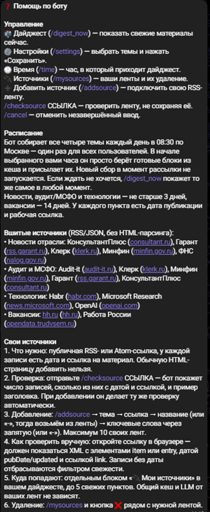
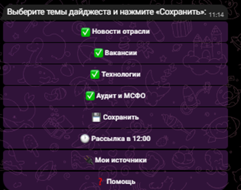
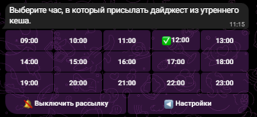
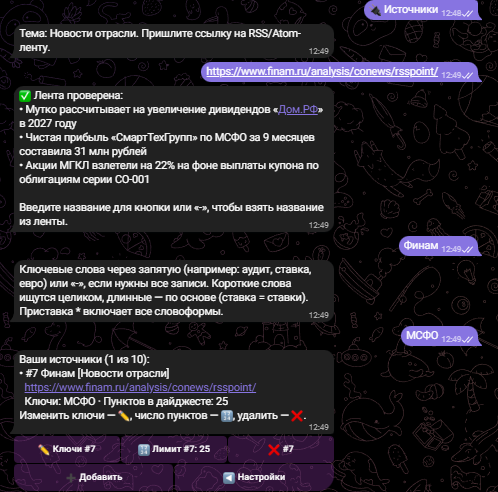
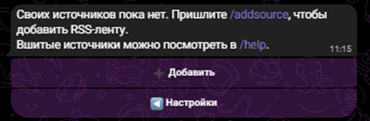
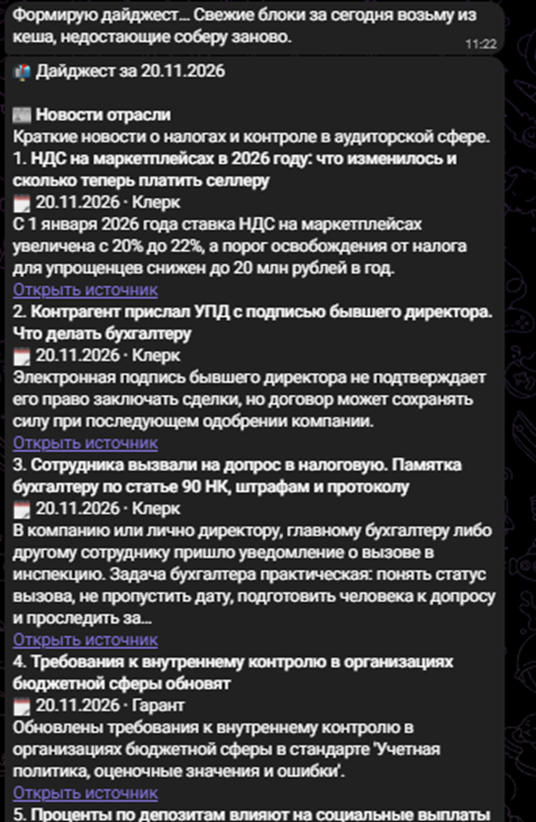
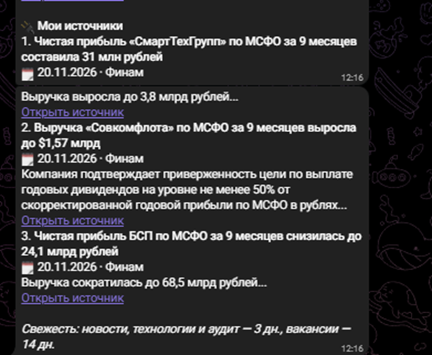

# Telegram-бот утреннего AI-дайджеста

MVP: бот собирает материалы из проверенных RSS/JSON-источников, LLM делает
краткие конспекты, а каждый пункт выводится с **датой публикации и ссылкой на
источник**. Сбор происходит один раз в день, а рассылка — в удобный каждому
пользователю час из уже готового кеша.

## Возможности

- **Кнопки управления** под полем ввода: «📬 Дайджест», «⚙️ Настройки»,
  «🕐 Время», «❓ Помощь», «🔌 Источники», «➕ Добавить источник»,
  «🚫 Отписаться». Команды (`/digest_now`, `/settings`, `/time`, `/help`,
  `/mysources`, `/addsource`, `/unsubscribe`) работают тоже.
- `/start` — регистрация и выбор тем через инлайн-клавиатуру.
- `/settings` — темы открываются с уже сохранёнными галочками.
- `/time` — выбор часа доставки с 09:00 до 23:00 или «Выключить рассылку».
- `/unsubscribe` (кнопка «🚫 Отписаться») — снять все темы и остановить
  авторассылку; ленты и время сохранены, вернуться можно через `/settings`.
- `/help` — справка: команды, расписание, список вшитых источников и
  инструкция по своим лентам.
- `/digest_now` — дайджест по всем темам в любой момент. Доступен всем.
- **Расписание:** сбор всех четырёх тем ежедневно в **08:30** по Москве
  (независимо от пользователей), рассылка — в начале выбранного часа из кеша.
  Новых вызовов LLM при рассылке нет.
- **4 вызова LLM в день** — по одному на тему, сколько бы ни было подписчиков.
- Свежесть: новости, аудит/МСФО и технологии — не старше **3 дней**, вакансии —
  не старше **14 дней**. Материалы без даты отбрасываются.
- У каждого пункта: дата, источник и кликабельная ссылка. Дата/ссылка/заголовок
  берутся из источника, а не из ответа LLM.
- Пустая тема не исчезает: бот честно пишет, что свежих материалов не найдено.
- **Свои RSS/Atom-ленты:** добавление с автоматической проверкой, список,
  редактирование ключей и лимита по каждой ссылке, удаление, отдельный блок
  «🔌 Мои источники» в персональном дайджесте.

## Стек

Python 3.11+, aiogram 3.x, APScheduler, SQLite (WAL, без ORM), Redis (TTL 24 ч),
feedparser, httpx, Gemini (Google AI Studio) с OpenAI-совместимым fallback,
Docker + docker-compose.

## Структура проекта

```text
bot/
  handlers.py     меню, команды, callbacks, FSM добавления источника
  keyboards.py    Reply-меню, инлайн-клавиатуры тем/времени/источников
  help.py         справка и список вшитых источников
  utils.py        отправка длинных HTML-сообщений
  main.py         запуск polling + двух jobs планировщика, сброс webhook
scheduler/
  jobs.py         сбор в 08:30, почасовая доставка из кеша
database/
  db.py           SQLite: users (темы, время, отметка отправки), custom_sources
sources/
  base.py         даты, свежесть, нормализация ссылок
  rss.py          RSS-ленты (Consultant, Garant, Klerk, Минфин, ФНС, Audit-it, Habr, OpenAI)
  hh.py           RSS hh.ru + резервный API «Работа России»
  custom.py       проверка и чтение пользовательских лент
  __init__.py     источники по темам, дедупликация, лимиты
services/
  cache.py        Redis + память процесса, ключ digest:v3:<topic>:<date>
  llm.py          JSON-конспекты, проверка на выдуманные факты
  render.py       HTML-пункты с датой и ссылкой
  digest.py       персональная склейка из кеша + блок своих лент
tests/            60 тестов ядра
docs/screenshots/  скриншоты для блока «Демонстрация работы»
docker-compose.yml  сервисы bot и redis
Dockerfile          образ бота
requirements.txt    зависимости
.env.example        шаблон переменных окружения
```

## Где хранятся подписки

`database/db.py` — это **код создания и обновления схемы**, а сами данные лежат
в файле SQLite:

- при локальном запуске — `bot.db` в корне проекта (`DB_PATH=bot.db` в `.env`);
- при запуске через Docker — `./data/bot.db` на хосте, внутри контейнера
  `/data/bot.db` (см. `volumes` в `docker-compose.yml`).

Файл создаётся автоматически при первом запуске: `bot.main` вызывает
`init_db()`, а при каждом следующем запуске та же функция обновляет схему
(добавляет новые колонки) без потери данных. В репозитории файл **не хранится**
намеренно: `bot.db`, `bot.db-wal`, `bot.db-shm` и `data/` записаны в
`.gitignore`, чтобы в GitHub не попали реальные user_id и ссылки. Поэтому в
репозитории виден только скрипт, а рабочая база появляется у вас на диске после
запуска бота.

Посмотреть данные можно так:

```powershell
Get-Item .\bot.db
.\.venv\Scripts\python.exe -c "import sqlite3; c=sqlite3.connect('bot.db'); print(c.execute('select * from users').fetchall()); print(c.execute('select id, topic, keywords, max_items from custom_sources').fetchall())"
```

Если хотите смотреть базу в **DBeaver**, не выбирайте папку `bot` — это
Python-пакет, а не база. В настройках соединения SQLite поле «Файл базы данных»
должно заканчиваться именно на `bot.db`. Путь проекта содержит кириллицу и
знак `№`, поэтому DBeaver иногда обрезает его до `...\bot`. Надёжный вариант —
сначала скопировать базу в папку с латинскими именами:

```powershell
$dst = "C:\Temp\digest_db"
New-Item -ItemType Directory -Force $dst | Out-Null
Get-ChildItem -LiteralPath . -Filter "bot.db*" | Copy-Item -Destination $dst -Force
```

Затем в DBeaver: **Database → New Database Connection → SQLite → File** и
укажите `C:\Temp\digest_db\bot.db`. Копия нужна только для просмотра: правки в
ней не попадут в работающего бота.

Пока процесс бота запущен, рядом могут существовать `bot.db-wal` и `bot.db-shm`
— это служебные файлы режима WAL; удалять их вручную не нужно. Копируйте все
три файла `bot.db*`, чтобы увидеть последние изменения. Для сдачи достаточно
скриншота или обезличенной копии базы, настоящий `bot.db` коммитить не следует.

## Где лежит кеш дайджеста

Готовые блоки хранятся **не в SQLite**, а в Redis — контейнере `redis`
(`docker-compose.yml`). В SQLite лежат только подписки, время и свои ленты.
Ключ имеет вид `digest:v3:<тема>:YYYY-MM-DD`, дата — московская:

```text
digest:v3:news:2026-11-20
digest:v3:jobs:2026-11-20
digest:v3:tech:2026-11-20
digest:v3:msfo:2026-11-20
```

Посмотреть кеш:

```powershell
docker compose exec -T redis redis-cli --scan --pattern "digest:v3:*"
docker compose exec -T redis redis-cli ttl "digest:v3:news:2026-11-20"
docker compose exec -T redis redis-cli get "digest:v3:news:2026-11-20"
```

`GET` отдаёт готовый HTML-блок темы: заголовок, даты, источники и ссылки.
TTL полного блока — 24 часа (`86400` сек), пустой темы — 30 минут (`1800`).
Данные Redis сохраняются в именованном volume `vpyp022_redis_data` за счёт
`appendonly yes`. Если Redis недоступен, бот временно держит такие же блоки
только в памяти процесса — снаружи их не увидеть, и они пропадут при
перезапуске. Свои RSS-ленты в кеш не кладутся: они читаются свежими при каждом
запросе.

## Пошаговый запуск и тест (PowerShell)

Все команды выполняются из папки проекта.

### Шаг 1. Перейдите в папку проекта

```powershell
cd "C:\Users\user\Desktop\Zerocoder DZ\VPyp02. Учебный проект №2"
```

### Шаг 2. Окружение и зависимости

Виртуальное окружение `.venv` уже создано. Если его нужно пересоздать:

```powershell
python -m venv .venv
.\.venv\Scripts\python.exe -m pip install -r requirements.txt
```

### Шаг 3. Настройки

Откройте `.env`:

```powershell
notepad .env
```

Минимальный набор:

```dotenv
BOT_TOKEN=123456789:AA...
TELEGRAM_PROXY=http://127.0.0.1:10809
LLM_PROVIDER=gemini
GEMINI_API_KEY=
PROXY_API_KEY=
REDIS_URL=redis://127.0.0.1:6379/0
DB_PATH=bot.db
DIGEST_MAX_AGE_DAYS=3
DIGEST_MAX_AGE_DAYS_JOBS=14
DIGEST_COLLECT_TIME=08:30
```

`TELEGRAM_PROXY` нужен, только если `api.telegram.org` с этой машины напрямую
недоступен; если прокси не запущен — оставьте значение пустым. Если заполнен
`GEMINI_API_KEY`, сначала используется Gemini; при отказе по геолокации
автоматически включается ProxyAPI.

### Шаг 4. Тесты до запуска

```powershell
.\.venv\Scripts\python.exe -m pytest -q
.\.venv\Scripts\python.exe -m ruff check .
docker compose config --quiet
```

Ожидаемо: `60 passed`, `All checks passed!` и пустой вывод от `docker compose`.

### Шаг 5. Поднимите Redis

Docker Desktop должен быть запущен:

```powershell
docker compose up -d redis
docker compose ps
```

Без Redis бот работает на резервном кеше в памяти процесса ( TTL тот же, но
кеш пропадёт при перезапуске). Для доставки в 14:00 это значит, что сбор в 08:30
и рассылка должны идти в одном и том же процессе.

### Шаг 6. Запустите бота

```powershell
.\.venv\Scripts\python.exe -m bot.main
```

В консоли:

```text
Активный бот: @your_bot (id=...)
Планировщик запущен: сбор в 08:30, рассылка каждый час по настройкам пользователей
```

Окно должно оставаться открытым. Остановка — `Ctrl+C`.

### Шаг 7. Проверьте в Telegram

1. `/start` — клавиатура управления и инлайн-переключатели тем.
2. Включите темы, нажмите «💾 Сохранить».
3. «🕐 Время» или `/time` — выберите, например, `14:00`; бот подтвердит.
4. `/help` — справка со списком вшитых источников и инструкцией по своим лентам.
5. `/checksource https://…/rss.xml` — проверка ленты без сохранения.
6. `/addsource` — тема → ссылка → название → ключевые слова; лента появится в
   «🔌 Источниках» и в блоке «Мои источники» дайджеста.
7. `/mysources` — кнопки `✏️ Ключи #ID` и `🔢 Лимит #ID`: поменять ключи или
   число пунктов с этой ленты (от 1 до 5), `❌ #ID` — удалить.
8. `/digest_now` — показать дайджест немедленно.
9. `/unsubscribe` или кнопка «🚫 Отписаться» — снять подписки и остановить
   авторассылку. Повторная подписка — `/settings`.

Чтобы не ждать 14:00, можно временно выбрать ближайший час (`09:00` и т.д.) —
доставка придёт в начале этого часа, уже из утреннего кеша.

Кеш и TTL:

```powershell
docker compose exec redis redis-cli keys "digest:v3:*"
docker compose exec redis redis-cli ttl "digest:v3:news:2026-11-20"
```

База (темы, время, свои ленты):

```powershell
.\.venv\Scripts\python.exe -c "import sqlite3; c=sqlite3.connect('bot.db'); print(c.execute('select user_id, topic_news, digest_time, digest_enabled, last_sent_date from users').fetchall()); print(c.execute('select id, user_id, topic, name from custom_sources').fetchall())"
```

### Запуск всего через Docker

```powershell
docker compose up --build -d
docker compose logs -f bot
```

Внутри compose бот получает `REDIS_URL=redis://redis:6379/0`, база — `./data/bot.db`.
Остановка: `docker compose down`.

## Переменные окружения

| Переменная | Назначение |
| --- | --- |
| `BOT_TOKEN` | токен из @BotFather; код не зависит от конкретного токена |
| `TELEGRAM_PROXY` | прокси для `api.telegram.org`; пусто = без прокси |
| `LLM_PROVIDER` | `gemini` или `proxy` |
| `GEMINI_API_KEY`, `GEMINI_MODEL` | ключ Google AI Studio и модель |
| `PROXY_API_KEY`, `PROXY_BASE_URL`, `PROXY_MODEL` | резервный OpenAI-совместимый провайдер |
| `REDIS_URL` | адрес Redis |
| `DB_PATH` | путь к файлу SQLite |
| `DIGEST_MAX_AGE_DAYS` | свежесть новостей/аудита/технологий, по умолчанию `3` |
| `DIGEST_MAX_AGE_DAYS_JOBS` | свежесть вакансий, по умолчанию `14` |
| `DIGEST_COLLECT_TIME` | время планового сбора по Москве, по умолчанию `08:30` |

## Расписание и доставка

- `collect_digests` в `DIGEST_COLLECT_TIME` (08:30): `ensure_digests(force=True)`
  — свежие материалы, 4 вызова LLM, 4 блока в кеше с датой ключа сегодняшнего дня.
- `deliver_digests` каждый час в `:00`: выбирает пользователей с
  `digest_time = 'HH:00'`, `digest_enabled = 1` и без отметки за сегодня,
  склеивает текст строго из кеша, отправляет и пишет `last_sent_date`.
- Получатели времени до планового сбора не получают пустые заглушки: если кеша
  за сегодня ещё нет, рассылка пропускается.
- Смена времени обнуляет `last_sent_date`, поэтому новый час сработает даже в
  тот же день. Все галочки можно снять — рассылка выключится; то же делает
  `/unsubscribe`, но он ещё и снимает темы одной командой.
- `/digest_now` при отсутствии блоков соберёт их заново, но не сдвигает
  плановую рассылку.

## Демонстрация работы

Ниже — реальные скриншоты бота. Файлы лежат в `docs/screenshots/`, поэтому GitHub
показывает их как изображения, а не как текст.

### Меню и настройки

Меню `/help`:



Меню текущих настроек:



Выбор слота времени:



Добавление кастомного источника:



Список источников:



Проверка дайджеста, часть 1:



Проверка дайджеста, часть 2:



### Пример подписки

```text
/start
→ ✅ Новости отрасли, ⬜ Вакансии, ⬜ Технологии, ✅ Аудит и МСФО
→ 💾 Сохранить
→ 🕐 Время → 09:00
→ /mysources → ➕ Добавить → Новости отрасли → RSS РБК → ключевые слова
→ /mysources → ✏️ Ключи #1 → новая подборка ключей
→ /mysources → 🔢 Лимит #1 → 2
```

В базе это выглядит так (пустые темы = `0`, активные = `1`):

```text
user_id | topic_news | topic_jobs | topic_tech | topic_msfo | digest_time | digest_enabled
352628441 |     1     |     0      |     0      |     1      |   09:00     |       1
```

Отказ от подписки — `/unsubscribe` или кнопка «🚫 Отписаться»; в той же строке
все темы станут `0`, `digest_enabled = 0`, но источники и время останутся.

### Пример полученного дайджеста

Фрагмент реального сообщения (ссылка и дата пришли из ленты, конспект — из
исходного текста; LLM не подставляла ни дату, ни URL):

```html
📬 Дайджест за 20.11.2026

<b>📰 Новости отрасли</b>
1. <b>Ozon Банк сообщил об устранении сбоя в работе сервисов</b>
🗓 20.11.2026 · Новости
Ozon Банк восстановил работу сервисов после утреннего сбоя, сообщили РБК в кредитной организации.
<a href="https://www.rbc.ru/rbcfreenews/6afc075bd166eb02fcd90030">Открыть источник</a>

<b>📊 Аудит и МСФО</b>
За последние 3 дня свежих материалов не найдено.
```

Скриншот целого сообщения — в блоке «Демонстрация работы» выше.

### Пример лога автоматического запуска

```text
2026-11-20 08:29:58,121 INFO apscheduler.scheduler: Adding job tentatively -- it will be properly scheduled when the scheduler starts
2026-11-20 08:29:58,122 INFO apscheduler.scheduler: Adding job tentatively -- it will be properly scheduled when the scheduler starts
2026-11-20 08:30:00,003 INFO apscheduler.executors.default: Running job "collect_digests (trigger: cron[hour='8', minute='30'])" (scheduled at 2026-11-20 08:30:00+03:00)
2026-11-20 08:30:00,006 INFO scheduler.jobs: Плановый сбор дайджеста: обновляю все темы
2026-11-20 08:30:11,204 INFO scheduler.jobs: Тема news сгенерирована и закэширована (конспектов LLM: 7)
2026-11-20 08:30:22,517 INFO scheduler.jobs: Тема jobs сгенерирована и закэширована (конспектов LLM: 7)
2026-11-20 08:30:33,860 INFO scheduler.jobs: Тема tech сгенерирована и закэширована (конспектов LLM: 7)
2026-11-20 08:30:40,112 INFO scheduler.jobs: Тема msfo сгенерирована и закэширована (конспектов LLM: 3)
2026-11-20 08:30:40,118 INFO scheduler.jobs: Плановый сбор завершён, блоки готовы к рассылке из кеша
2026-11-20 09:00:00,004 INFO scheduler.jobs: Рассылка в 09:00: получателей 1
```


## Источники и свежесть

Все вшитые источники — RSS или JSON. HTML-страницы не парсятся.

| Тема | Источники |
| --- | --- |
| `news` | Consultant `hotdocs.xml` и `fd.xml`, Garant `categories/news`, Klerk, Минфин, ФНС |
| `msfo` | Audit-it (`news_audit`, `news_msfo`, `news_all`, `news_account`), Минфин, Garant, Klerk, Consultant — с фильтром МСФО/аудита |
| `tech` | Habr «Искусственный интеллект», Microsoft Research, OpenAI News |
| `jobs` | RSS `hh.ru/search/vacancy/rss` (без прокси) + резервный API `opendata.trudvsem.ru` |

Проверено 20.11.2026: `api.hh.ru` блокирует IP этой машины (`403`), но публичная
RSS-выдача hh.ru отдаёт свежие вакансии с датой и ссылкой. IAS Plus и IFRS.org
не используются: их страницы — SPA без RSS.

Свои источники:

- формат — публичная RSS/Atom-лента; у каждой записи должны быть дата и ссылка;
- проверка — `/checksource ССЫЛКА [ключи через запятую]` показывает число записей,
  число записей с датой и ссылкой, сколько подошло под ключи, и примеры
  заголовков; то же самое делается при `/addsource`, после сохранения бот
  пишет, сколько свежих записей подошло;
- фильтр — ключ ищется в заголовке или тексте. Короткие слова (до 4 букв,
  например `евро`) — только целиком, поэтому `евротройка` и `Европе` не
  проходят; слова в 5–6 букв режутся на одну букву (`ставка` → `ставк`
  ловит `ставки`, но не `ставший`); от 7 букв — на две; `евро*` явно включает
  все словоформы. Фильтр применяется **до** ограничения числом пунктов;
- лимит — 10 лент на пользователя; по умолчанию до 3 пунктов с ленты, но число
  меняется кнопкой `🔢 Лимит #ID` в `/mysources` (от 1 до 5). Весь блок «Мои
  источники» тоже ограничен 5 пунктами; свежесть та же (3 дня / 14 дней для
  вакансий), ключевые слова опциональны;
- редактирование — кнопки `✏️ Ключи #ID` и `🔢 Лимит #ID` в `/mysources`.
  При смене ключей лента скачивается заново: если под новые ключи не подошло
  ни одной записи, бот не сохранит их и попросит уточнить фильтр;
- изоляция — свои ленты не попадают в общий кеш и не вызывают LLM, поэтому не
  влияют ни на других пользователей, ни на число вызовов модели;
- удаление — `/mysources` и кнопка ❌; локальные/internal адреса запрещены.

## Как устроен дайджест и защита от выдумок

1. Источники возвращают `title`, `url`, `text`, `source`, `published_at`.
2. Материалы фильтруются по дате, дедуплицируются и сортируются «сначала новые».
3. LLM получает пронумерованный текст **без ссылок** и возвращает JSON
   `{"intro": "...", "items": [{"id": 1, "summary": "..."}]}`.
4. Конспект принимается, только если `id` существует, в нём нет URL/markdown и
   все числа и даты есть в исходном тексте.
5. Рендер сам подставляет заголовок, дату, источник и ссылку. LLM физически не
   может добавить выдуманный URL или дату.
6. Блок кладётся в Redis по ключу `digest:v3:<topic>:YYYY-MM-DD`; вчерашний
   дайджест сегодня не отдаётся даже при живом TTL.
7. Персональная сборка склеивает только включённые темы и блок «Мои источники».

## Если кнопки не работают

Код кнопок не привязан к токену, администратору или чату. Проверьте по порядку:

1. **Перезапустите процесс после смены токена** — `.env` читается при старте.
2. **Не запускайте два экземпляра с одним токеном** (Docker и локально).
3. В логе должна быть строка `Активный бот: @... (id=...)`.
4. При старте бот вызывает `delete_webhook`.
5. Старые callback-и обрабатываются ловушкой: «Кнопка устарела. Отправьте /start».
6. Reply-кнопки появляются после `/start`; если клавиатура не видна, отправьте
   `/start` ещё раз. Инлайн-клавиатуру можно открыть заново через `/settings`
   или `/time`.
7. Глобальный обработчик ошибок тоже отвечает на нажатие, если хендлер упал.

## Тестирование

```powershell
.\.venv\Scripts\python.exe -m pytest -q
.\.venv\Scripts\python.exe -m ruff check .
docker compose config --quiet
```

Покрыты: SQLite round-trip и миграция схемы, TTL и дата в ключе кеша, фильтр
свежести и разбор дат, дедупликация с `utm`, рендер с датой/ссылкой, защита от
URL и выдуманных чисел в LLM, кнопки и их callback-и, выбор времени и защита от
повторной отправки, отказ от подписки, сбор в 08:30 и доставка только из кеша,
проверка RSS, CRUD своих источников и редактирование ключей/лимита по ссылке,
справка со списком вшитых лент.

## Примечания

- FSM настроек и добавления источника живёт в памяти процесса: черновик до
  нажатия «Сохранить»/окончания ввода; источник истины — SQLite.
- `localhost` в `REDIS_URL` может не резолвиться — используйте `127.0.0.1`.
- Если Redis упал, блоки живут в памяти процесса с тем же TTL; в compose у Redis
  включён AOF.
- Пользовательские строки не удаляются при выключении рассылки: снятие галочек
  и `/unsubscribe` просто выключают отправку.
